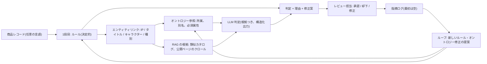
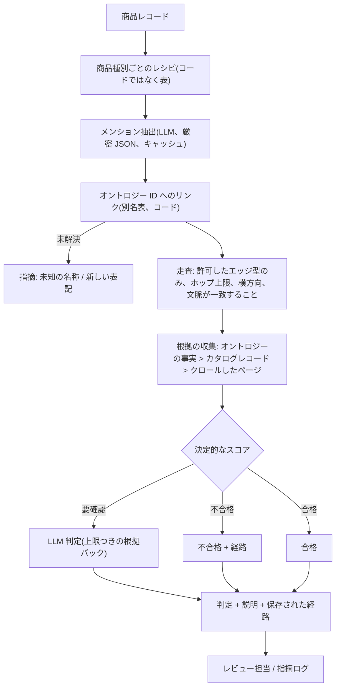
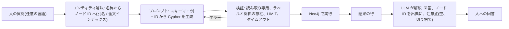
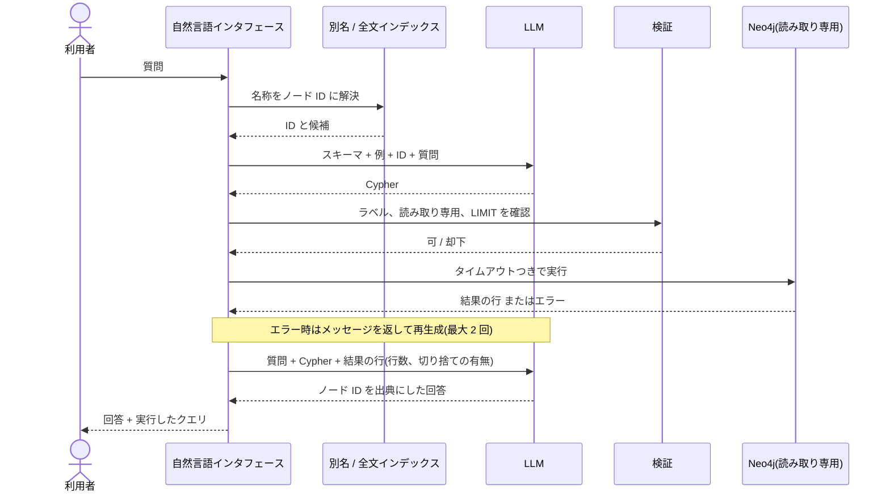

# ゲーム業界向け EC 商品登録チェック: グラフ活用 RAG エージェントの PoC 提案

## はじめに

ゲーム業界の EC では、ゲームソフトだけでなく、ダウンロードコンテンツ、フィギュア、カード、アパレルなど、多種多様な商品が日々大量に登録される。これらの商品は、IP(フランチャイズ)、タイトル、キャラクターといった共通の「世界観」の上に成り立っており、同じ IP が複数の媒体・商品形態・地域・言語にまたがって展開される。

商品登録の正しさを確認する作業は、現状では経験豊富な担当者の暗黙知に大きく依存している。「どこを見るべきか」は人によって異なり、商品ラインが増えるほど確認の負担は増える。桁数の誤りや不審な文字種といった形式的な誤りは固定ルールで検出できるが、次のような誤りはルールだけでは見つけにくい。

- ブランドやタイトルに属さないキャラクターが登録されている(構造の誤り)
- 名称の表記ゆれ、略称、地域ごとの別名の混在
- 商品種別ごとに必須となる記載(例: アパレルの素材組成率)の不足や不整合

そこで、**ルールによる 1 段目のチェック**と、**オントロジー(IP → ブランド/タイトル → キャラクターの階層と別名の定義)と LLM による 2 段目のチェック**を組み合わせ、さらに確認結果を次のルールやオントロジーの改善に反映する仕組みが求められている。

本書は、その実現に使えるグラフと RAG の手法を整理し、それぞれが何にどう役立つかを示す **PoC(概念実証)の提案**である。予算や体制、納期を扱う計画書ではなく、「どの方法が使え、どのように助けになるか」を明らかにすることを目的とする。提案の根拠として、社内で実施した問い合わせ対応 AI の検証(グラフ構築、固定パイプラインとエージェント探索の比較、評価基盤、継続デプロイ)の実測結果と実装資産を用いる。

ゲーム業界の個別事情に関する記述は、現時点で顧客資料がないため一般的な知識に基づく仮定であり、**[仮定]** と明記している。

---

# (1) 背景と目的

## 1.1 想定される業務と要望

- **現在の業務:** EC サイトにおける商品登録内容の確認。判断の多くが担当者の暗黙知にあり、確認すべき箇所は経験者の知識に依存している。商品ラインが増えるたびに作業量が増える。
- **要望:**
  1. 登録データを入力し、固定ルールだけでなく**オントロジーを使った LLM チェック**を行う。
  2. **フィードバックの自動化:** 使うほど精度が上がること。指摘と対応の記録を残し、AI が見直して修正案を出し、人がルールに反映し、そのサイクルを自動で回す。問い合わせ対応 AI と同じ考え方で、対象が「指摘と対応の記録」になる。
- **2 段階チェックの設計:**
  - **1 段目、ルールチェック:** 桁数の誤り、不審な文字種など。
  - **2 段目、オントロジー/AI チェック:** ルールでは見つけられないもの。階層 **IP → ブランド → キャラクター** に基づき、ブランドに属さないキャラクターを「構造違反」として検出する。あわせて、名称の正しい表記、キャラクター名の表記ゆれ、商品種別ごとの法定記載事項(例: アパレルは素材の組成を % で記載)を、過去の登録例の書き方に照らして判断する。
  - 過去に指摘された内容の再発は、AI が修正する。
- **見通し:** ルールチェック、オントロジー AI チェック、ログ取得を一通り動かすところまでを、問い合わせ対応 AI で既に行っていることの延長で実現する。
- **留意点:** クレジットカードの不正検知より重い作業になり得る。中心となるのは裏側の厳密な構造であり、整合性チェックには「何が正しいか」の定義が必要になる。与えられた情報でどこまでできるかを試す性質の取り組みである。
- **未着手の事項:** 詳細な資料やタスクの共有は、まだ受け取っていない。

## 1.2 作業上の前提と、まだ決まっていないこと

以下は現時点の前提である(資料の共有後に顧客と確認する)。

| 論点 | 作業上の前提 | 提案への影響 |
|---|---|---|
| 対象の EC サイトと商品ライン | **汎用的**に扱う。主にゲーム関連を想定するが、特定のタイトルや店舗に限定せず、ゲーム業界全般に通用する方法とする | ドメインモデルは汎用的なゲーム業界モデル(パブリッシャー、IP、タイトル、エディション、プラットフォーム、キャラクター、関連商品)とし、個別の顧客固有の値は組み込まない |
| 誰が、どれだけ登録するか | EC なので**商品数が非常に多く**、登録者も多い。グラフは、それらを裏側でつなぐ構造になる | 商品ごとにノードとエッジを足すだけで拡張できること。1 件あたりのチェックは安価であること(ルールと参照を先に、LLM は最後) |
| 過去の指摘・対応記録 | **存在しない。** それでも RAG は前提とし、どのグラフ手法でも **EC の生データ**、または**Web クロール**を使った RAG による拡張を行う | 履歴による正解セットは使えず、フィードバックは「ゼロから」始まる。根拠は既存カタログと公開ページから得る。評価は誤りの人工注入で行う(2.6 参照) |
| IP・ブランド・キャラクターのマスタ | 提案するエージェントを使う**システムは顧客側が所有**する | 提案するのは仕組みと、オントロジーの立ち上げ方。マスタ本体とその保守は顧客のシステム内にあり、エージェントは狭いインタフェース(参照、変更提案)で接続する |
| 言語と表記 | **柔軟**であること。主に日本語、ただし世界展開を想定 | エンティティは言語非依存の ID とし、言語ごとの別名を持たせる。言語をまたいだリンクが機能すること |
| 予算・体制 | **その種の提案ではない。** 使える手法とその効果を示す PoC 提案 | スケジュール、人員、納品物の日付は含めない。第 2 章で手法を比較し、価値を示す小さな PoC を定義する |

PoC に必要な範囲で、まだ決まっていない事項:
- EC の生データの形(項目、規模、言語)と、PoC にサンプルを使えるか。
- クロールの可否と、使ってよい公開情報源(公式サイト、wiki、ストアページなど)。
- システムがオントロジーを DB、API、ファイルのいずれで公開し、エージェントが参照できるか。
- 現状、レビュー担当者が指摘をどう扱っているか(判定結果の出力設計のため。履歴がないので簡潔でよい)。
- PoC におけるデータセキュリティ条件(データをどこで処理してよいか)。

## 1.3 活用できる既存資産

| 資産 | 所在 | この提案での関連 |
|---|---|---|
| キーワード抽出(LLM、厳密な JSON、プロンプト版ごとにキャッシュ)とキーワード共起グラフ | `data_ontology_r_and_d_project/marat/step-01-extract-keywords.js`、`step-02-graphs-compare.js`、`inquiry-databricks-01-extract-keywords.js`、`inquiry-databricks-02-build-graph.js` | 自由記述からのエンティティ・用語の抽出。キャッシュにより再実行が安価で再現可能。共起グラフは弱いグラフであり、本件で必要なのは型付きで権威のあるグラフ |
| 「タグ」パイプライン: キーワード抽出 → グラフノードのシード → 数ホップ展開 → 文書ランキング → 文脈の上限設定 → 回答 1 回 → 判定 | `data_ontology_r_and_d_project/marat/inquiry-common.js`(`runTagsPipeline()`)、`inquiry-databricks-04-qa-eval-tags.js` | 固定パイプラインが自由な ReAct エージェントに勝った(下表) |
| 判定(judge)ハーネス(正確性ゲートと網羅性、v1.1)と結果表 | `data_ontology_r_and_d_project/marat/inquiry-databricks-04-qa-eval-tags.js` ほか | チェック結果を正解セットで採点する用途に再利用できる |
| デプロイ: Databricks 上の QA アプリと、キーワードグラフを毎晩再計算して再デプロイするジョブ | `data_ontology_r_and_d_project/marat/inquiry-databricks-09-deploy.js` | 「指摘が入り、ルールとグラフが再構築される」ループにそのまま使える形 |
| 簡易オントロジー、用語辞書、略語・同義語表、Microsoft GraphRAG のビルドジョブ、共通評価指標 | `data_ontology_r_and_d_project/ito/knowledge_base/retrieval_augmentation/customer_support_jpn/simple_ontology.json`、`term_dictionary.json`、`abbreviations_synonyms.json`、`data_ontology_r_and_d_project/ito/databricks_jobs/graphrag_build/build_graphrag_index.py`、`data_ontology_r_and_d_project/common/eval/` | 別名・同義語の扱い、既製の評価指標、GraphRAG インデックスの経験 |
| Neo4j の仮想グラフ層(概念と ID のみ)を Delta テーブルと Vector Search の横に置く構成。GrepGraph(Cypher)、SPARQL、hop=1/hop=2 展開、エージェント探索 | `data_ontology_r_and_d_project/yoda/app/graphrag/expansion.py`、`grep_pipeline.py`、`sparql_pipeline.py`、`data_ontology_r_and_d_project/yoda/docs/architecture_graphrag.md`、`data_ontology_r_and_d_project/docs/ontology_rag_summary.md` | オントロジーとデータの分け方、展開の設計 |

問い合わせ対応 AI の検証(340 問、judge v1.1)から持ち込む、実測に基づく知見:

| 知見 | 結果 |
|---|---|
| 自作グラフに対する自由なエージェント探索 | 正確性 68%、合格率 41%。エージェントがグラフに存在しないキーワードを作り出した |
| 同じグラフに対する固定「タグ」パイプライン | 正確性 78%、合格率 50%(Databricks コーパス)。YAML コーパスでは 72% / 54% |
| GraphRAG の hop=2(共起する概念を介した横方向の展開)と hop=1 の比較 | 全指標で hop=2 が優位。親カテゴリへの上方向の展開はノイズを増やし、hop=1 に劣った(`data_ontology_r_and_d_project/docs/ontology_rag_summary.md`) |
| ID が異なる準重複文書 | 再現率が約 65% で頭打ち。意図レベルの一致指標で本当の品質が見えた |

## 1.4 目的(一文)

PoC として、ゲーム業界の EC 商品登録チェッカーに、IP・タイトル・キャラクターの明示的なオントロジーを与え、EC の生データと公開情報による根拠を添えることで、固定ルールでは捕まえられない構造と表記の誤りを検出し、すべての指摘に根拠を示し、顧客側が所有するオントロジーに接続できる、グラフと RAG の手法を明らかにする。

---

# (2) 提案

## 2.1 基本方針: グラフは検索インデックスではなく「規則書」

問い合わせ対応 AI では、グラフは質問に対する文書を*探す*のに使われた。本件では、入力が**商品レコード**、出力が**判定**(OK / 要確認 / 誤り、理由と修正案つき)になる。したがってグラフの主な役割は、**「正しい」の権威ある定義**になることである。検索は二次的で、類似するカタログのレコードと公開情報の該当箇所を LLM への根拠として取り出す(取り出すべき過去の指摘はまだない)。

この方針から次のことが導かれる。
- エッジは共起回数ではなく、**型付きで人が管理する**(所属、別名、必須項目)。自作のキーワードグラフは候補の*提案*には有用だが、判定には使わない。
- LLM はグラフが与える狭い枠の中で**判断し、説明する**。真実を作り出させない。これは、キーワードを作り出した自由エージェントから得た教訓である。
- 一般的な意味での GraphRAG(大規模コーパスのコミュニティ要約、Microsoft 方式)は中心に置かない。使うのは、エンティティリンク、近傍展開、過去事例の検索のうち適合する部分のみ。

## 2.2 ドメインモデル(オントロジーが保持すべきもの)

ゲーム業界で汎用的に使える形とする。ゲームとその関連商品は IP(フランチャイズ)を軸に、複数の媒体や商品形態、地域、言語にまたがって展開される。**[仮定]** 登録チェックに必要なモデリングは次のとおり。

```
権利者 / パブリッシャー / 開発元  --保有・許諾-->  IP(フランチャイズ)
IP  --持つ-->  シリーズ / タイトル / シーズン      (ゲームタイトル、サブシリーズ、アニメのシーズン)
タイトル  --持つ-->  キャラクター / ユニット / アイテム / モード
タイトル  --発売形態-->  エディション × プラットフォーム × 地域      (通常版、限定版、コレクターズ、家庭用、PC、モバイル、国内、グローバル)
エンティティ(IP、タイトル、キャラクター)  --別名-->  言語ごとの名称と表記バリエーション
商品種別  --必須-->  必須属性      (ゲームソフト、DLC・デジタルアイテム、フィギュア、カード、アパレルなど)
商品  --所属-->  IP / タイトル / キャラクター / 商品種別 / エディション / プラットフォーム / 地域
```

すべては**言語非依存の ID** と、言語ごとのラベル・別名で保持する。これにより、日本語、英語、中国語、韓国語などを同じノードで扱える。オントロジーは**顧客側のシステムが所有**し、エージェントは参照でき、変更は*提案*のみできる。

明示的にモデル化すべきゲーム業界固有の事情 **[仮定、各項目を要確認]**:
- **1 つの IP、多様な形態:** 同じキャラクターがゲームのキャラクターであり、フィギュア、カード、アパレル、デジタルアイテムでもある。名前が存在するかだけでなく、「このタイトルの、この形態で有効か」を判定する必要がある。
- **タイトルとエディション:** ゲームタイトルにはプラットフォーム、エディション、地域、DLC の接尾辞が付く。タイトルに紐づく関連商品は、そのタイトルの公式表記を使う必要がある。同じゲームでも地域ごとに名称が異なることが多い。
- **クロスオーバーとゲスト参戦:** キャラクターが別タイトルに正当に登場する(コラボ、オールスター作品)。「1 キャラクター = 1 タイトル」と厳格に決めると誤検知が出る。したがって関係は多対多とし、*文脈*(コラボ、イベント、期間)を持たせる。
- **表記バリエーション:** 公式名、略称、愛称、新旧名称、半角・全角、ひらがな・カタカナ・ローマ字、括弧やサブタイトル、他言語の文字への音訳。言語ごとに正規形を 1 つ持つ別名表が、表記チェックの土台になる。
- **権利表記とレーティング:** IP ごとに固有の著作権表記が必要になることが多い。ゲームには地域ごとに異なる年齢区分がある(例: 日本の CERO、海外の ESRB や PEGI)。1 段目で存在を、2 段目でタイトルと地域に合っているかを確認できる。
- **時間:** 発売日、ブランド名の変更、再販、シーズン限定キャラクター。ある時期には正しく、別の時期には誤りとなる登録がある。

## 2.3 チェックパイプライン



1. **1 段目、ルール。** 通常のコードで LLM は使わない。桁数、許容文字種、商品種別ごとの必須項目、日付・価格の妥当性、権利表記の有無。高速、安価、説明可能であり、大規模な EC カタログの全レコードに必ず実行する唯一の段階である。
2. **エンティティリンク。** 厳密な JSON を返すキーワード抽出プロンプトを使うが、オントロジーの語彙に制約する。LLM は言及(メンション)を提案し、コードが別名表に対して解決する(言語をまたぐ一致には多言語埋め込みが有効)。解決できないものは、それ自体が指摘になる(「未知のキャラクター / 新しい表記」)。
3. **オントロジーチェック(まず決定的に):** キャラクターはタイトルに属するか、タイトルは IP に属するか、表記は当該言語の正規形か、商品種別の必須属性は揃っているか。多くの「構造違反」は LLM を使わずにここで決まる。
4. **RAG による根拠。** リンクされたノードの近傍(1 ホップ、横方向: 同じタイトル、同じキャラクター、同じ商品種別。hop=2 の考え方)を参照し、ベクトルインデックスで最も類似する既存のカタログレコードを取得する。範囲はグラフで絞る。カタログに答えがない場合は、**公開情報源のクロール**(公式サイト、ストアページ、wiki)から引用を得る。クロールしたテキストは出典と日付つきの「根拠」であり、レビューなしでオントロジーの事実にはしない。
5. **LLM 判定。** 文脈を上限つきで 1 回の呼び出し(タグパイプラインの形)で行う。入力はレコード、グラフの事実、取得した根拠。出力は構造化し、判定、依拠したルール/オントロジー ID、根拠の引用、修正案、確信度を含める。グラフの事実と矛盾する出力は、コードが却下する。
6. **レビューとログ。** すべての判定を、入力とレビュー担当の判断とともに保存する。このログが、まだ存在しない「過去の指摘」の蓄積の起点になる。

## 2.4 フィードバックループ(PoC 水準)

履歴がないため、ループは空の状態から始まり、その価値は小規模に示す。
- 定期ジョブ(問い合わせ AI のデプロイと同じ形: Databricks ジョブ、そして再デプロイ)が、指摘ログからレビュー担当の判断を読む。
- **AI が提案し、人が承認する。** AI は、新しいルール、新しい別名、不足しているタイトルとキャラクターのエッジ、誤検知の繰り返しによって緩めるべきルールを起案する。承認された変更だけが、顧客側システムの狭い書き込みインタフェース(版管理、誰がいつ)を通じてオントロジーやルールに入る。
- 以後のチェックは、まず指摘ログを参照する。これにより、再学習なしで「過去に指摘された内容を AI が修正する」ことが成り立つ。
- PoC では、注入した誤りか手動でレビューした指摘に対してループを 1 回回し、次の実行の挙動が変わることを示せば十分である。

## 2.5 利用できるオントロジーがない場合の作り方

オントロジーは顧客側のシステムが所有するが、PoC には照合先が必要になる。安価な順に:
- **マスタのサンプルを使う**(共有できる場合。最良のケースで、構築が不要)。
- **EC の生データから立ち上げる:** キーワード抽出で商品名と説明からエンティティ、別名、関係を提案し、共起とタグパイプラインでどのタイトルとキャラクターが一緒に属するかを確認する。人が提案を確認する。これにより、顧客自身のスキーマと比較できる*スキーマのたたき台*も得られる。
- **公開情報源のクロールで補強する**(言語ごとの公式名称、発売地域)。レビューまでは別の「候補」ノードとして保持する。
- **保存先(後で決める):** (a) ノード、エッジ、別名の Delta テーブルと、根拠用の Vector Search、グラフのロジックはコード。最小構成で、すべて Databricks 内に収まる。(b) グラフクエリが複雑になる場合は、概念と ID のみを持つ Neo4j の仮想グラフ層(`data_ontology_r_and_d_project/yoda/docs/architecture_graphrag.md` の設計)。実システムは顧客側が所有するため、PoC では保存先を、実システムが提供するのと同じ参照/提案インタフェースの背後に隠す。

## 2.6 過去の指摘がない場合の評価

- **誤りの注入による正解データ。** EC データのうち正しく見えるレコードを、既知の方法で壊す。キャラクターを別タイトルに入れ替える、名称を表記バリエーションや別言語の形に置き換える、必須属性を落とす、権利表記やレーティングを変える、地域を混ぜる。壊したレコードには誤りの種類が付くため、種類ごとの再現率を測れる。これに加えて、顧客側のレビュー担当が付与したラベルつきの小さなセット(50〜100 件程度)を用意し、注入した誤りが実際の誤りに似ているかを確認する。
- **否定例:** 手を加えていないレコード。実際のカタログには誰も指摘していない本当の誤りも含まれる。手を加えていないレコードへの指摘はすべて人が確認し、確認されたものが最初の本物の指摘になる。
- **指標:** 誤りの種類ごとの適合率、再現率、100 件あたりの誤検知、修正案の採用率、1 件あたりのレイテンシとコスト。`data_ontology_r_and_d_project/common/eval/` と判定ハーネス(正確性ゲートと網羅性)を再利用し、MLflow に記録する。
- **適合率が重要な理由:** 誤検知が多いチェッカーは、レビュー担当に信頼されなくなる。まず適合率の高いチェックから始め、後で広げる。
- **言語:** 数値は言語別に報告し、言語をまたぐ弱点が見えるようにする。
- **根拠の質:** クロールしたページに基づく指摘は、引用元が実際にその内容を述べているかを確認する。

## 2.7 手法の比較と、それぞれがどう役立つか(PoC の本題)

| 手法 | 内容 | 本件での効果 | 弱点 |
|---|---|---|---|
| A. ルールのみ | 決定的チェック(1 段目) | 形式、文字種、必須項目の欠落を、全レコードに安価に検出できる | キャラクターとタイトルのような関係は見えない |
| B. 単純な RAG | 類似するカタログレコードや公開ページを取得し、LLM が判定 | オントロジーの構築が不要。近傍との比較で表記のずれを見つけられる | 根拠自体が誤っていることがある。準重複でスコアが水増しされる。「正しい」を定義できない |
| C. キーワード/共起グラフ(自作) | 抽出したキーワードから作るグラフ | 生データから、エンティティ、別名、「同じ所属らしい」候補を安価に立ち上げられる | 権威がない。共起は所属ではない |
| D. 型付きオントロジー + 固定パイプライン(提案の中心) | IP / タイトル / キャラクター / 別名 / 商品種別のグラフ。決定的な所属チェック。上限つき文脈での LLM 判定 | 「正しい」を定義できる。指摘を説明できる。ノードの追加で拡張できる。別名により多言語に対応できる | 保守されるオントロジーが必要(顧客側システムが所有) |
| E. Microsoft 方式の GraphRAG | 大規模コーパスに対するコミュニティ要約 | 生テキストの構造の*発見*とクラスタの説明に有用 | 構築コストが高い。質問応答向けに調整されており、レコード単位の検証には向かない |
| F. エージェント型グラフ探索 | LLM がグラフツールを自由に呼ぶ | 探索には柔軟 | 問い合わせ AI の検証ではキーワードを作り出し、固定パイプラインに負けた。チェック経路には入れない |

PoC が見込む答え: 大半は A、構造と表記は D、根拠には B とクロール、C と E はオントロジーを*作る*ためのツール、F は人による場当たり的な探索のみ。

## 2.8 PoC のスコープ

- **データ:** EC 生データのサンプル(数千レコード、可能なら 2〜3 言語)と、いくつかのフランチャイズ。
- **構築:** 1 段目のルール、そのサンプルから立ち上げたたたき台のオントロジーに対するエンティティリンク、オントロジーチェック、カタログサンプルからの RAG 根拠(クロールは任意の 2 つ目の情報源)、構造化された判定を返す LLM 判定、最小限のレビュー一覧と指摘ログ。
- **示すもの:** 注入した誤りに対する、手法 A、B、D の誤りの種類ごとの結果(2.7 の表を数値にしたもの)、提案ループ 1 回分、実システムが公開すべきもの(オントロジーの参照、変更提案)の短いメモ。
- **対象外:** スケジュール、体制、予算、本番向けの堅牢化、レビュー一覧を超える UI。

## 2.9 リスク

- **本物の正解セットがない。** 注入した誤りは、実際の誤りより易しい、または異なる可能性がある。対策: レビュー担当がラベルを付けた小さなセットと、数値が合成データに基づくことの正直な報告。
- **汎用化と具体性。** 非常に汎用的なモデルは、ゲーム固有の落とし穴(エディション、地域、クロスオーバー)を隠すことがある。対策: これらを明示的にモデル化し(2.2)、それぞれ最低 1 件の注入ケースでテストする。
- **クロールした根拠が誤りまたは無許諾の可能性。** 対策: 出典と日付を保持し、根拠としてのみ扱い、クロール前に利用規約を確認する。
- **オントロジーの所有。** 実際のオントロジーは顧客側システムにあり、その形が我々のたたき台と異なる場合、インタフェース(参照、提案)が差を吸収する必要がある。
- **硬直した階層による誤検知**(コラボ、ゲストキャラクター)。対策: 文脈つきの多対多の関係と、「誤り」だけでなく「要確認」というレベルを持つこと。
- **GraphRAG の研究への脱線。** 対策: チェック経路は手法 A、B、D に限り、C と E は立ち上げにのみ使う。
- **セキュリティとデータの所在。** 商品データは機密の可能性がある。開始前に PoC をどこで動かすかを決める。

## 2.10 顧客への確認事項(PoC に必要なものだけ)

1. EC 生データのサンプル(項目、数千行、言語)を提供してもらえるか。
2. 公開情報源をクロールしてよいか。好ましい、または禁止される情報源はあるか。
3. システムはオントロジーをどう公開するか(DB、API、ファイル)。小さなサンプルでも見られるか。
4. レビュー担当に、PoC 用に 50〜100 件のラベル付けを 1 時間ほどお願いできるか。
5. PoC をどこで動かしてよいか(当方の Databricks、顧客側)。
6. レビュー担当が指摘を信頼するには、指摘に何が示されている必要があるか。

## 2.11 実用例 (a): 完全カスタムのグラフエージェント(検索とグラフ走査の規則を自前で決める)

**考え方。** グラフを中核に置くが、フレームワークや自由に動く LLM エージェントに制御を渡さない。何を調べるか、どのエッジをたどるか、どこまでたどるか、根拠をどう採点して合わせるか、いつ止めるかという方針を、自分たちで書く。LLM は末端にのみ現れる(テキストからのメンション抽出、上限つきの根拠パックの判断、説明の記述)。



**自分たちで決めること**
- **商品種別ごとのチェックレシピ。** ゲーム、DLC、フィギュア、アパレルごとに、どのチェック(ルール、次にどのオントロジーチェック、どの根拠源)を走らせるかを表で定める。新しい商品種別は、コードではなく表の新しい行になる。
- **走査方針。** チェックごとに許可するエッジ型(例: キャラクター → タイトル → IP、別名 → 正規名)、ホップ上限、横方向のみの展開(hop=2 の知見に沿い、同じタイトルの兄弟ノード)。文脈つきのエッジ(コラボ、地域、期間)は、レコードの文脈が一致する場合にのみたどる。
- **根拠の順位付け。** 信頼の順序を固定する: オントロジーの事実、カタログのレコード、クロールしたページの順。時間に依存する事実は新しいものが優先。情報源間の矛盾は、黙って解決せず報告する。
- **スコアと停止。** 各チェックは経路つきで合格 / 要確認 / 不合格を返す。LLM は「要確認」の中間だけで呼ばれるため、大規模カタログでもコストとレイテンシを抑えられる。
- **すべてを経路として記録する。** 判定を導いた走査を保存するため、レビュー担当は「キャラクター X → タイトル Y: エッジなし。最も近いタイトル: Z(2025 年のコラボ)」のように確認できる。これが説明になる。

**実用例**
1. レコード単位の登録チェック(2.3 の主ケース)。
2. リンク候補の提案: 新しい商品について、そのテキストから IP、タイトル、キャラクター、エディションを、経路を根拠として提案する。
3. 兄弟の一貫性: 同じタイトルのすべてのエディションや商品は、権利表記、レーティング、表記で一致するはず。外れ値を指摘する。
4. 表記の正規化: 任意の言語の任意のバリエーションを正規の別名に対応づけ、どの別名に一致したかを示す。

**既存資産の再利用。** タグパイプライン(抽出、シードノード、b ホップの展開、ランキング、上限つき文脈、1 回の呼び出し)は既にこの形をしており、問い合わせ AI の検証で自由エージェントに勝った(`data_ontology_r_and_d_project/marat/inquiry-common.js`)。展開の方向は hop=2 の知見で定まる(`data_ontology_r_and_d_project/yoda/app/graphrag/expansion.py`)。採点には判定ハーネスと `data_ontology_r_and_d_project/common/eval/` を使う。

**強み:** 予測可能、安価、説明可能、ルールごとにテストできる。**弱み:** 新しい状況ごとにルールやエッジが必要で、ルール群に管理者が要る。

## 2.12 実用例 (b): Neo4j の大規模な生グラフと自然言語インタフェース

**考え方。** (a) の正反対。作り込んだオントロジーも固定パイプラインも使わない。EC データを大規模な**生グラフ**(商品、タイトル、キャラクター、販売者、カテゴリ、属性、地域と、生データから読み取れるエッジ)として Neo4j に読み込み、人が**自分の言葉で質問**できるようにする。流れは次のとおり。



同じ流れを、安全確認と再試行の位置が分かるシーケンスで示す。



**実用例**
- レビュー担当やデータ管理者による監査と調査: 「キャラクター X を、Y 以外のタイトルに入れている商品はどれか」「このタイトルの商品のうち、権利表記が異なるものはどれか」「韓国語の登録のうち、年齢区分がないものはいくつか」「このキャラクターに紐づくすべてのものを、地域をまたいで見せる」。
- **ルールの発見:** 繰り返し本物の誤りを見つける質問は、(a) のルールになる。過去の指摘がない状況で、足りないルールを見つけるためのツールになる。
- オントロジーを変更した際の影響分析(「このキャラクターを別のタイトルに移したら、どの商品が影響を受けるか」)。

**設計上のポイント**
- **Cypher を生成する前に名称を解決する。** 利用者の言葉を別名・全文インデックスでノード ID に対応づけ、ID をプロンプトに渡す。エージェント探索の検証では、エージェントがグラフに存在しないキーワードを作り出して失敗した。この手順でその失敗をなくす。
- **まずテンプレート、次に自由生成。** よくある質問はパラメータ化した Cypher テンプレートに対応づける(確実)。それ以外のみ、スキーマ、少数の例、エラーのフィードバックによる再試行(最大 2 回)つきの自由生成に回す。
- **安全性:** 読み取り専用のデータベースユーザ、スキーマに対するラベルと関係型の検証、`LIMIT` の必須化、クエリのタイムアウト、プロシージャの禁止。最も危険な失敗はエラーではなく、もっともらしいが空や誤った行を返すクエリである。そのため解釈の段階で、何を問い合わせ、何行返ったかを明示する。
- **解釈:** LLM は行を要約し、ノード ID を出典として示す。行にない事実は加えない。
- **規模:** 名称にインデックス、別名に全文インデックス、あいまい一致にはベクトルインデックスも任意で用いる。値は多言語、スキーマのラベルは英語とする。

**既存資産の再利用。** `data_ontology_r_and_d_project/common/graph_agentic_search.py` の `GraphAgenticSearcher` が既にこの一種を実装している。システムプロンプトにスキーマ、`LIMIT` 必須(最大 20)の `cypher_query` ツール、`vector_search` による補完を備え、問い合わせ対応のグラフ上で動く(グラフの構造は `data_ontology_r_and_d_project/docs/graphrag_neo4j_hop.md`)。

**評価。** 正解の Cypher または正解の回答を付けた質問セットを用い、実行可能率、結果一致率(実行の正確性)、解釈の忠実性、レイテンシを測る。テンプレートと自由生成を比較する。

**強み:** 柔軟で、データの中身が見え、開始にオントロジーが要らない。**弱み:** 回答の質は生グラフの質次第。自由な Cypher は誤りやすい。調査用ツールであり、全レコードの確認を保証できない。

## 2.13 (a)、(b) とチェッカーの関係

| | 中核のチェッカー(2.3) | (a) カスタムエージェント | (b) 生グラフへの NL → Cypher |
|---|---|---|---|
| 答える問い | このレコードは正しいか | このレコードは正しいか、何であるべきか | データに何があるか。どこが変か |
| 誰が尋ねるか | システム(レコードごと) | システム(レコードごと) | 人(その場で) |
| グラフの内容 | 管理されたオントロジー | 管理されたオントロジーと根拠 | 生で、大規模で、未整理 |
| LLM の役割 | 判定 | 末端のみ | クエリを書き、結果を読む |
| 主なリスク | オントロジーの保守 | ルールの保守 | 正しく見える誤ったクエリ |

両者は組み合わさる。(b) で生グラフからパターンを見つけ、有用なものは (a) のルールとエッジになり、(a) がすべてのレコードにそれを適用する。

## 2.14 その他のアイデアと未解決の論点

上記より適している可能性があるアイデア:
1. **近傍からの外れ値検出(オントロジー不要)。** 生グラフで、兄弟の中で珍しい値(タイトル内の他と異なる権利表記、他のエディションにないレーティング)を指摘する。安価で決定的、管理されたオントロジーが存在する前の初日から使える。最初の PoC の一歩として最適かもしれない。
2. **エンティティ解決を独立した成果物として。** 3 通りに綴られた同一キャラクターや、二重登録された同一商品を、別名と近傍のクラスタリングで見つける。クラスタは最初の別名表にもなる。
3. **クロールの代わりに、公開ナレッジグラフを種として使う。** Wikidata のような公開知識ベースは、多くのゲームとキャラクターの多言語ラベルを公開ライセンスで持っている(利用条件は要確認)。Web ページのクロールより安全に、言語をまたぐ別名を補える可能性がある。
4. **入力時のチェック。** 登録者が入力している最中に、オントロジーから候補(タイトル候補、正規名、必須項目)を提示し、後で見つけるのではなく誤りを未然に防ぐ。
5. **エッジに時間を持たせる。** 所属やコラボのエッジに有効期間を持たせ、再販やブランド名変更が誤検知を生まないようにする。
6. **確信度の階層と自動化率。** 自動合格、自動指摘、人に回す、の階層に分け、カタログのどれだけがそれぞれに入るかを報告する。事業側が気にするのはその数値である。
7. **後でレビュー担当の説明から学ぶ。** 指摘が蓄積したら、確認済みの指摘を、判定のための検索型の少数例(few-shot)として使う。再学習は不要。

決めるべき論点(当方と顧客の双方で):
1. PoC の主軸はどれか: レコード単位のチェッカー(2.3 と (a))、調査用インタフェース((b))、外れ値のアイデア(上記 1)。
2. 生の EC グラフの規模(ノードとエッジ、言語)はどれくらいか。Neo4j は許容されるか、顧客側の保存先を使う必要があるか。
3. エージェントは助言だけか、書き込み(オントロジー変更の提案や適用)もするか。承認者は誰か。
4. チェッカーは入力時(登録の最中、数秒)か、バッチ(カタログに対する夜間処理)か。これにより 1 レコードあたりに使える LLM の量が変わる。
5. 自然言語インタフェースを使うのは誰で、どの言語で質問するか。
6. 権利や法定記載事項について、クロールや公開情報源は許容されるか、顧客自身のデータのみにする必要があるか。
7. 過去の指摘がない状況で「良い」をどう定義するか: サンプルでのレビュー担当の一致、目標の誤検知率、自動化率。
