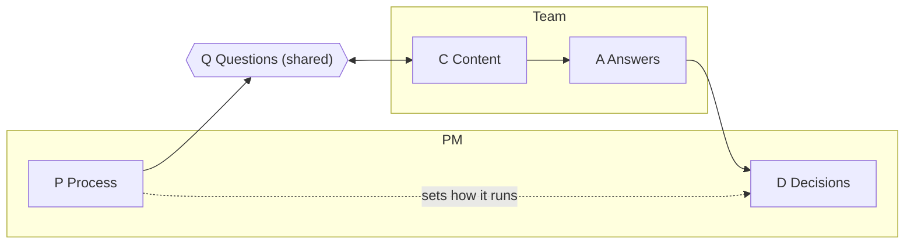
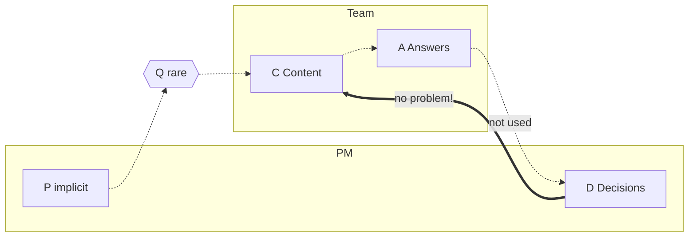
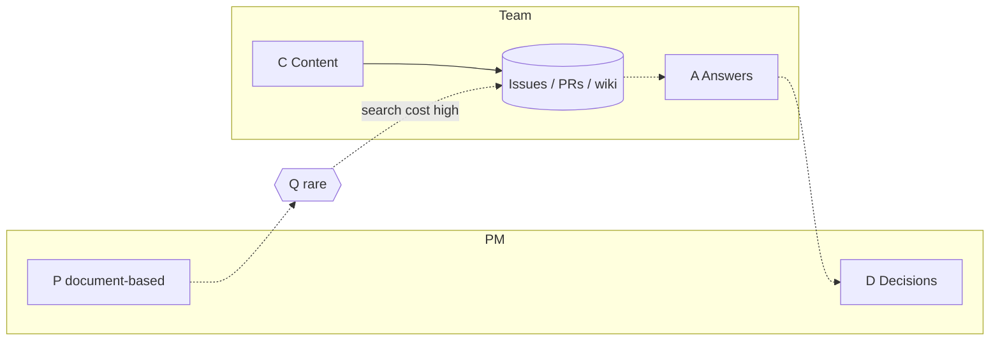
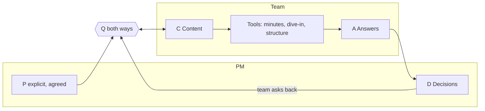
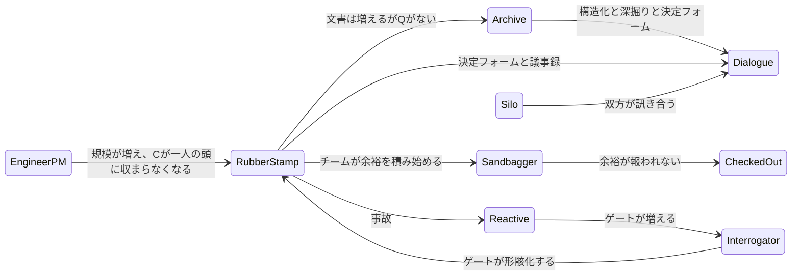
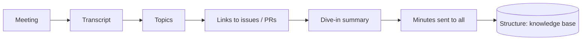

## 「大丈夫そうですね」の一週間後

複雑な開発をしていると、こんな場面に出会います。打ち合わせで「大丈夫です、動くはずです」という空気になり、そのまま話がまとまる。そして一週間後に、初めてこんな話が出てきます。

- 鍵ファイルは誰が、どうやって先方に渡すのか
- 先方の環境で、そもそもSSHは使えるのか
- 失敗したとき、誰がサポートするのか

この言葉は、誰の口からも出ます。私自身も言う側になります。そういう場面に何度か立ち会ううちに、「あの会議に足りなかったのは何だろう」と考えるようになりました。この記事は、その考えごとの記録です。

考えた道筋は次の三つです。

1. 足りなかったものを「道具で解けるもの」と「方法でしか解けないもの」に分けてみる
2. 議論の中の情報の流れを **DPQCA** という5文字で描いてみる
3. それを使って、チームを9つの型に分けてみる

型ごとに5語のフレーズも付けました。個人的には、これが一番気に入っています。

:::message
筆者は ICA の ToP (Technology of Participation) ファシリテーション認定を受けています。この記事は ToP の解説ではなく、特定の人や組織を論じるものでもありません。一つのチームで過ごした経験から出てきた、仮説の段階の話です。以下、PdM を含めて PM と書きます。
:::

## 1. 「器」と「循環」のあいだ

ToP で学んだことは、私の中で大きな財産です。焦点化された会話（ORID：Objective / Reflective / Interpretive / Decisional）、コンセンサス・ワークショップ、アクションプランニング。いずれも、グループの全員が参加し、同じ方向を向くための進め方です。ファシリテーターは中立で、内容には踏み込まず、決めるのはグループです。

つまり ToP は、会議の**器**です。

一方、PDCA は仕事そのものの**循環**です。製品やプロセスを、反復の中で良くしていきます。

私が気になったのは、そのどちらでもない場所でした。

| | **ToP** | **DPQCA**（この記事） | **PDCA** |
|---|---|---|---|
| 対象 | 会話の進め方 | 議論や意思決定の中を流れる**情報** | 仕事・製品 |
| 答える問い | 全員が参加し、揃っているか | その決定は事実に基づいているか | 仕事は良くなっているか |
| 単位 | 会議・ワークショップ | 会議の中と、会議と会議のあいだの Q・A・D の流れ | 数週間〜数か月の周期 |
| 関係 | 器 | 器の中を流れる中身 | DPQCA を内側に含む（計画もレビューも議論だから） |

器がどれほど良くても、中に入る情報が薄ければ、決定は薄いままです。PDCA を回しても、計画の議論が薄ければ、薄い計画が回るだけです。

なお、ToP のアクションプランニング（前提、現状、主要アクション、カレンダー、調整）は、後述する「具体化」にかなり近く、この記事でも語彙として借ります。ToP が扱わないのは、**会議と会議のあいだで、誰が誰に何を訊くか**です。

## 2. 現場で起きたこと

先に言葉を決めます。**具体化**とは、抽象的な合意に「誰かが実行でき、うまくいったと確認できる」ために必要なものを足すことです。

### ケースA：コンテナ再起動の手順書

「先方がクラウド上のコンテナを自分で再起動・再構築できるよう、手順書を作る」。その場では「大丈夫そうだ」で話がまとまりました。ところが、実行に近づくと、次のことが暗黙に前提されていたことが分かってきました。

- 鍵ファイルの受け渡し
- 先方側にSSHできる環境があること
- 権限
- 私が普段、自分の端末で何も考えずに打っているコマンド
- 失敗時の対応と、サポートの担当

特に最後から二つ目が印象的でした。実行する側にとって当たり前のことほど、言葉になりません。

### ケースB：共同開発の「ここだけ先方の関数」

「この関数は先方だけが触り、こちらは触らない」という合意がありました。しかし、次のことが決まっていませんでした。

- そのコードを、どのリポジトリ・ブランチ・PRで編集するのか
- デプロイできるのは誰か
- レビューとロールバックはどうするか
- 関数のインターフェースの約束は何か

### 「大丈夫そうだ」はスコープの言葉

どちらも「何をやるか」（スコープ）のレベルで合意が止まっていました。スコープから最初の一歩までのあいだには、次の6つが必要だったように思います。これが私の考える具体化の中身です。

| # | 次元 | 平易な問い | ケースA | ケースB |
|---|---|---|---|---|
| 1 | 事実 | 具体的に何を？ | どのコンテナ？どのリソース？ | どの関数、どのリポジトリ？ |
| 2 | 前提 | 何が成り立っていないといけない？ | 先方にSSH・鍵・権限がある | デプロイ権限の持ち主が決まっている |
| 3 | 担当 | 誰がやる？誰が決める？ | 先方の運用者か、こちらか | 編集は先方、デプロイは？ |
| 4 | 順序 | どの順で、いつから？ | 再起動手順を一歩ずつ | 編集→レビュー→デプロイ |
| 5 | 失敗 | 何がうまくいかない？ | 鍵違い、環境違い、中途半端な再構築 | 両側が同時に編集 |
| 6 | 完了 | どうなれば成功？ | 先方が一人で再起動できる | デプロイでき、こちらが止まらない |

### 必要だったのは「ドメイン知識」か？

最初に思いつく説明は、「その分野の技術の知識が足りなかったから」です。それも一理あります。確かめるために、あのとき抜けていた項目を数え、何があれば埋まったかを分けてみました。

| 区分 | 例 | 件数 |
|---|---|---|
| 汎用の問い（誰が、何が前提で、どう確認する） | 誰がデプロイするか／どう編集するか／無意識の手順を一度なぞる | 3 |
| 薄い地図（世の中にどんなカテゴリがあるか） | 鍵の受け渡しが要る／先方にSSH環境が要る／関数の契約が要る | 3 |
| 深い技能 | 手順書に書く正確なコマンド | 1 |

7件のうち6件は、深い技術力ではなく、**問いと薄い地図**で埋まります。サンプルは小さいので傾向の話ですが、こう考えてみました。

> **具体化は「地図」を知ること、ドメイン知識は「地形」を知ること。**

たとえば、PythonにはAPI用のフレームワークがいくつもあると知っているのが地図。Django・FastAPI・Flaskの違いを知っているのが地形です。DBマイグレーションという概念を知っているのが地図。Djangoでの実行方法を知っているのが地形です。地図があれば問いは出せます。地形は、答える側が持っていればよいのです。

もう一つ、情報が多すぎる問題もありました。PRの説明にも issue にも全部書いてあるのに、いざ動くときは何もつながっておらず、断片を探し回ってから全体像を組み立てることになります。

## 3. 道具で解ける問題と、方法でしか解けない問題

足りなかったものは、性質が二つに分かれます。

| 足りないもの | 区分 | 理由 |
|---|---|---|
| 事実、会議と issue のつながり | **道具** | 取り出しと連結のコストの問題 |
| 前提、環境の制約 | **道具** | 知識はある。届くまでが高い |
| 散らばった情報 | **道具** | 構造化のコストの問題 |
| 鍵の受け渡し、手順 | **方法** | 人と人の合意が要る |
| 共有関数の境界 | **両方** | 項目は書式にできるが、「権限」の意味はチームで決める |

道具は、技術で劇的に良くできます。方法は、チームで合意しなければ始まりません。道具については後半で作るものを紹介します。方法の側には、「誰が何を訊くのか」を語る共通のモデルが必要だと感じました。それが次の節です。

ひとつ補足です。人は、「訊くコスト」が「訊かないリスク」より低いときに訊きます。忙しいとき、コードから離れているとき、訊くコストは上がり、訊かないリスクは小さく見えます（「動くはず」）。これは誰にでも起きますし、私にも起きます。**道具は訊くコストを下げ、方法は訊かないことのコストを見えるようにします。**

## 4. 核心：DPQCA

### 5つの文字

| 文字 | 単語 | ここでの意味 | 持ち主 |
|---|---|---|---|
| **D** | Decisions | スコープ、優先度、リソース、顧客への約束の決定 | PM |
| **P** | Process | 問いの出し方、答えの作り方、決め方 | PM（ToPではファシリテーター） |
| **Q** | Questions | 抽象から具体へ動かす行為 | **共有** |
| **C** | Content | 技術的な知識と、システムの現状 | チーム |
| **A** | Answers | Q に対して C から作られる具体的な返答 | チーム（P を通して PM に届く） |

文章にするとこうです。

> **PM は決定（D）とプロセス（P）と問い（Q）を持ち、チームはコンテンツ（C）と答え（A）を持つ。問いは両側で共有される。**

問いが両側にあるのは、チームも PM に訊くからです。優先度、顧客の事情、期限。これは PM が持つ「ビジネス側の内容」です。

### 5つのルール

| # | ルール | 破れたときの例 |
|---|---|---|
| R1 | 決定には答えが要る（A → D） | 具体的な答えのないまま、決定が進む |
| R2 | 答えには問いが要る（Q → A） | SSHの詳細を知っている人がいるのに、誰も訊かない |
| R3 | 問いは両側から出る | 決める人には訊きづらく、チームからの問いが減る |
| R4 | P が、誰が何を訊き、答えをどこに置くかを決める | 答えが、出席者だけが覚えている会議の中に消える |
| R5 | C は、持ち主がコードから離れると薄れる | 規模や役割が変わり、全体が一人の頭に収まらなくなる |

### 具体化は Q、ドメイン知識は C

最初の考えが、これで一文になります。

> **「C を PM に移さないといけない」わけではない。安くて十分なのは「Q を PM に移す」ことではないか。**

日本語の「きく」には、聴く・聞く・訊く・効くがあります。DPQCA の Q は「訊く」、つまり自分から尋ねる行為です。聴くのはファシリテーションの基本ですが、訊かれなければ答えは出てきません。そして、決定に「効く」答えが返ってくるかどうかが、A の質です。

### ToP との違い：決めるのは誰か

| | ToP のファシリテーター | DPQCA の PM |
|---|---|---|
| プロセス、問い | 持つ | 持つ |
| 内容 | 持たない（中立） | 薄く持つ（地図） |
| 決定 | **持たない**（グループが決める） | **持つ**（D は PM の役割） |
| 帰結 | 中立だから、自由に訊ける | 決める側の質問は、意図せず審査に聞こえやすい。帽子を明示する |

決める人が訊くと、同じ質問でも承認テストのように聞こえることがあります。「理解したいので、どれくらいかかるか教えて」という帽子だと分かれば、返ってくる答えは変わります。どの帽子で訊いているかを言葉にするのは、P の仕事です。これは PM に限らず、決定権を持つ人なら誰にでも当てはまります。

### PDCA ではありません

P・D・C・A は、PDCA の4文字でもあります。ここでは Process・Decisions・Content・Answers を指します。PDCA は**仕事**を良くする循環で、DPQCA は各フェーズの**議論**の中身を描きます。紛らわしいので、この記事では初出のたびに単語を添えます。

### 失敗は二つある

- **Q が出ない**：誰も訊かない
- **A が空**：具体性のない返答（「大丈夫です」）だけが返ってくる

この二つは別の状態です。

| | **A が具体的** | **A が空・防御的** |
|---|---|---|
| **Q が出る** | Dialogue、Engineer-PM（一人の頭の中で訊く） | Interrogator（答えが儀式になる）、Sandbagger（答えに余裕が積まれる） |
| **Q が出ない** | Archive（答えは書いてあるが誰も訊かない）、Silo（答えがチーム内に留まる） | Rubber stamp（「大丈夫です」）、Checked-out、Reactive（事故が起きるまで） |

## 5. チームの型

同じ5文字でも、どの文字が働いているかで、チームの姿が変わります。

### 表記

| 文字 | 大文字 | 小文字 | `_` |
|---|---|---|---|
| **D** | PM が決める | 決定が曖昧、またはチームが決める | 誰も決めない |
| **P** | 明示され、全員が知っている | 暗黙、その場しのぎ | ない |
| **Q** | 両側から、早い段階で | 少ない、一方向、儀式化 | ない |
| **C** | 記録されている、または決める人が使える（PM の頭の中を含む） | チームの頭の中だけ、または出てこない | 失われた |
| **A** | 具体的な答えが D の**前**に届く | 一部だけ、水増し、防御的 | ない、または空（「大丈夫です」） |
| `*` | 文字の後ろに付ける。決定や事故の**後**に来る | | |

**すべて大文字になるのは Dialogue だけ**です。

### 9つの型

人ではなく、情報の流れの状態に付けた名前です。どのチームも、時期によってどれかの型に近づいたり離れたりします。

| 型 | コード | 何が起きているか | よくある環境 |
|---|---|---|---|
| **Rubber stamp** | `D p q c _` | 「問題なし」で決まり、確認されないまま引き渡しを迎え、驚く | 依頼が壁越しに飛ぶ受託型の開発 |
| **Sandbagger** | `D p q c a` | Q が軽い。チームは約束しすぎないよう見積もりに余裕を積む | 過去に約束しすぎて痛い目を見たチーム |
| **Checked-out** | `D p _ c _` | 問いも答えもない。品質は静かに落ちる | チケット消化中心の組織 |
| **Reactive** | `D p q* c a*` | 問いは事故の後に来る。同じ事故が別の日に起きる | 消火活動中心のチーム |
| **Interrogator** | `D P q c a` | 汎用の問いが一方向に大量に来る。答えは「正解」の暗記になる | ゲートレビュー、変更審査会、規制の強い環境 |
| **Silo** | `d p _ c _` | 決定がチームの中で完結し、外からは見えない | 技術リード中心のチーム、基盤チーム |
| **Engineer-PM** | `D p q C A` | すべてが一人の頭の中にある。その人に時間がある間は機能する | 初期のスタートアップ、5人以下 |
| **Archive** | `D p q C _` | 全部記録されているが、つながっておらず届かない | 成熟した GitHub・Wiki 環境 |
| **Dialogue** | `D P Q C A` | 答えが決定の前に届き、問いが両側から出る | 設計書に Q&A がある、議事録が issue につながっている |

3つの型を図にします（実線は働いている流れ、点線は弱い、または途切れた流れです）。

**Rubber stamp**：答えが使われないまま、決定が先に走ります。

**Archive**：書いてあるが、探すコストが高くて、誰も訊きません。

**Dialogue**：道具が C を A に変え、チームも訊き返します。

### 私が身を置いていた状況

振り返ると、Rubber stamp と Archive が同時に起きている状況でした。「大丈夫そうだ」が先に走り（問題1）、情報は書かれているのにつながっていない（問題2）。もともとは、技術に近い一人が全体を見ていた時期（Engineer-PM）があり、規模が大きくなるにつれて、全体が一人の頭に収まらなくなって今の形に移ったのではないか、というのが私の見立てです。Sandbagger の気配も少しあります。ここは決めつけず、チームで話してみたいところです。

この遷移は仮説で、一つのチームの経験が元になっています。

Sandbagger には一言添えておきます。これは**安定した状態**になりがちです。水増しが「訊かれていない」ことを覆い隠すので、コストが見えにくく、状態が長く続きます。

### なぜ Dialogue か

私が置く基準は3つです。(a) 答えが決定の**前**に届く、(b) 問いが両側から出る、(c) 一人の時間や知識に依存しない。3つとも満たすのは Dialogue だけです。Engineer-PM も (a)(b) は満たしますが、(c) を満たしません。規模が大きくなるほど、C を一人が持たなくても回る設計が必要になります。

:::message
「Dialogue が最良」は、私の開発環境から導いた設計上の仮説です。分野によっては、5文字への「重み」の配分が違う形のほうが合うかもしれません。たとえば規制の強い分野では P に、探索的な開発では Q と C に重みが寄るほうが自然かもしれません。
:::

### 9つの型を、5語で

型には名前があるほうが、記憶に残ります。そこで、各型に5語のフレーズを付けました。ルールは一つ。**D・P・Q・C・A の順に、1文字につき1語で、全体で意味が通ること。** 頭文字は、そのまま文字に対応します。

| 型 | コード | フレーズ | 読み |
|---|---|---|---|
| **Rubber stamp** | `D p q c _` | **D**eclare **P**erfect, **Q**uit **C**hecking, **A**pologise | 問題なしと宣言され、確認が止まり、引き渡しの段階で謝ることになる |
| **Sandbagger** | `D p q c a` | **D**umped, **P**added, **Q**uoted, **C**overed, **A**ppeased | 決定は投げられ、Q は軽い。チームは見積もりを盛り、身を守り、場をなだめる |
| **Checked-out** | `D p _ c _` | **D**utifully **P**resent, **Q**uietly **C**hecked-out, **A**bsent | 問いも答えもない。場には居るが、議論は動かない |
| **Reactive** | `D p q* c a*` | **D**ecide, **P**anic, **Q**uiz, **C**lean-up, **A**nalyse | 問いは事故の後に来る。事後検証として |
| **Interrogator** | `D P q c a` | **D**emand **P**roof, **Q**uiz **C**onstantly, **A**nnoy | 汎用の問いが大量に出る。答える側は「正解」を覚える |
| **Silo** | `d p _ c _` | **D**eliver **P**rivately, **Q**uietly **C**ode **A**lone | 決定はチームが持つ。報告はされるが、相談はされない |
| **Engineer-PM** | `D p q C A` | **D**ecide **P**ersonally, **Q**uickly **C**heck **A**nything | すべてが一人の頭の中にある。その人に時間がある間は機能する |
| **Archive** | `D p q C _` | **D**ocument **P**rofusely, **Q**uit: **C**an't **A**ccess | 記録はあるが、届かない |
| **Dialogue** | `D P Q C A` | **D**ecide **P**rudently: **Q**uestion, **C**larify, **A**gree | 健全 |

フレーズはモデルではなく、タグです。ただ、型ごとに文字が違う単語に置き換わるので、P・D・C・A が PDCA に見えてしまう問題を、読んでいるあいだ中、中和してくれます。

あなたのチームのコードを書いて、フレーズも作ってみてください。

## 6. 道具をつくる

ここからは、これから作る道具の話です。どれも「訊くコストを下げる」ためのもので、まだ作っている途中のものを含みます。

| 道具 | 解く問題 | 何をするか | DPQCA での役割 |
|---|---|---|---|
| **議事録** | ニュアンスだけの会議、担当や手順のぶれ | 会議後に、GitHub の issue へのリンク付きで議事録を自動生成し、全員に送る | **D** を **C** につなぐ |
| **議事録＋深掘り** | 「大きな絵だけ」で決まる | 各トピックについて、複雑さ、関わるサービス、必要な環境、場合によっては関連コードを PM が読めるレベルで添える | **D** の前に、**A** を先回りして用意する |
| **構造（Structure）** | 情報の散らばり | 既存のドキュメントをつなぐ知識ベース。長期の別プロジェクト | **C** をたどれるようにして、**Q** を安くする |
| **決定依頼フォーム**（方法＋書式） | ケースA・B | スコープ・前提・担当・権限・失敗時の扱い・完了条件 | **D** の瞬間に、標準の **Q** を出す |

道具が**できないこと**もはっきりしています。道具は訊くコストを下げますが、誰かに訊かせることはしません。それは P、つまり方法の仕事です。続きは別の記事で書きます。

## 7. まとめ

- あの場面に見えてきたのは、C（ドメイン知識）よりも、Q（問い）の流れだった
- 道具は Q を安くし、方法は Q が起きるようにする
- 目指す姿は Dialogue。決定の前に答えが届き、問いが両側から出る

もし試すなら、次の二つが手軽です。

1. 「大丈夫そうですね」の後に、3つだけ訊く。**誰がやるのか／何が成り立っていないといけないのか／うまくいったと、どう分かるのか**
2. 自分のチームのコードを、一文字ずつ書いてみる

器を整えてくれた ToP に、感謝します。その中に何を流すかを考えるために、DPQCA を書きました。
